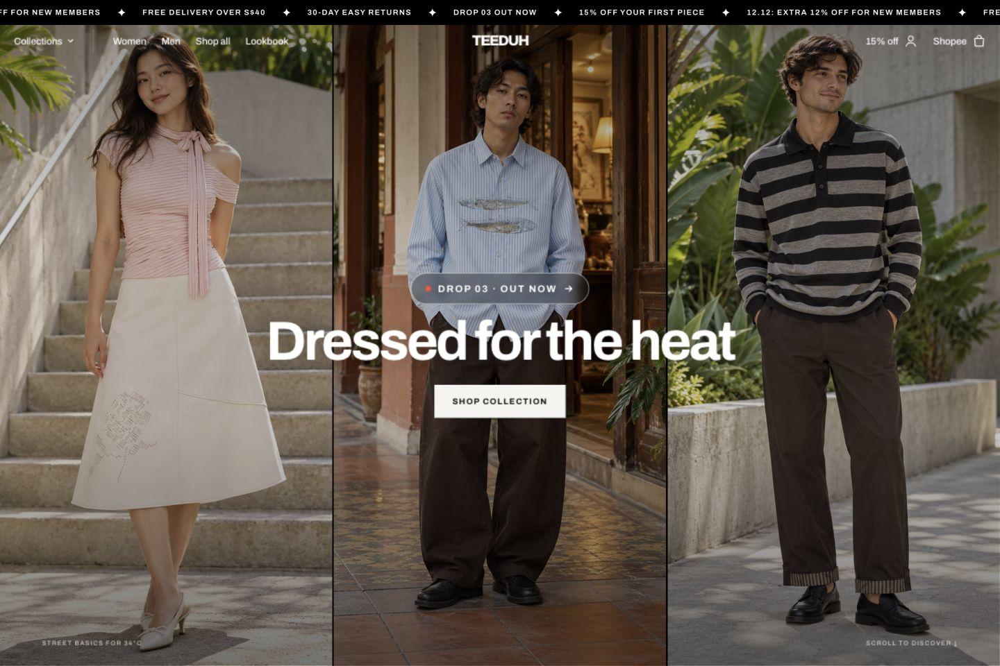
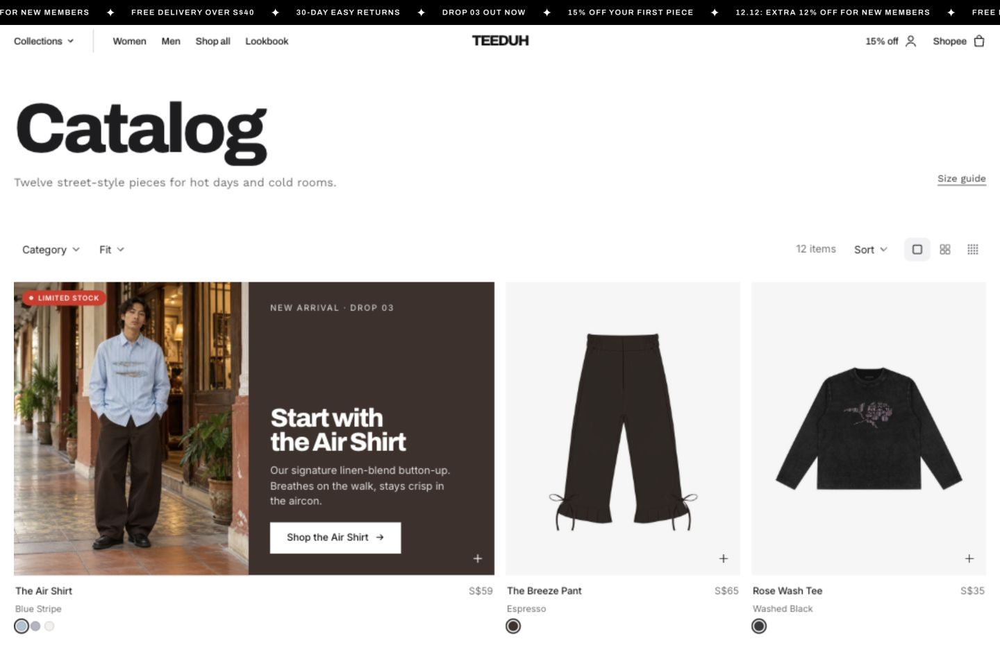
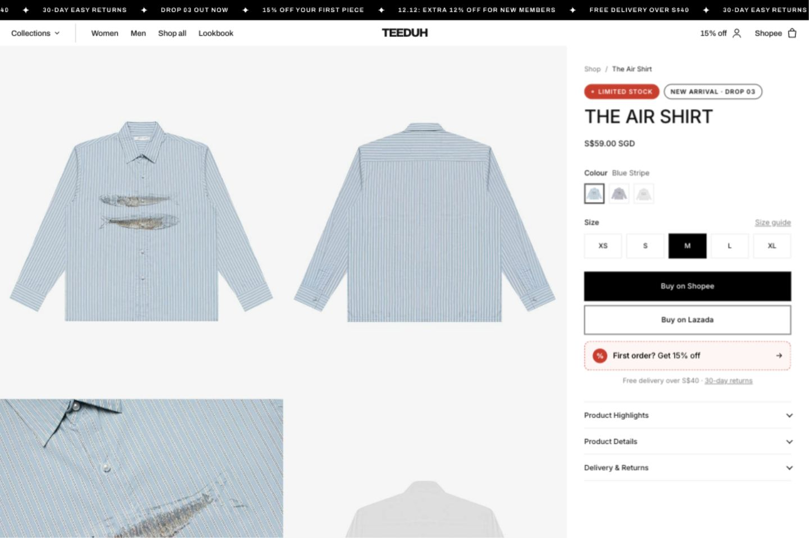
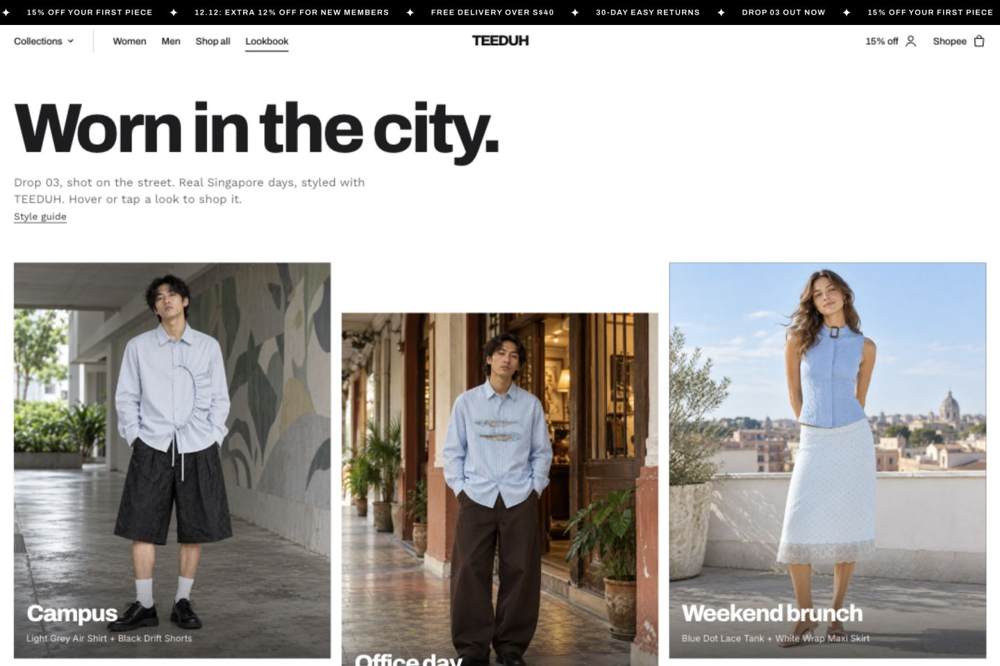
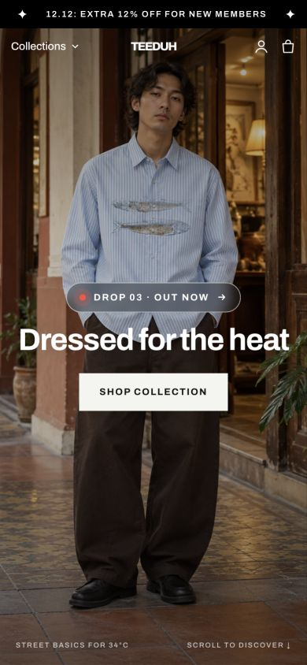
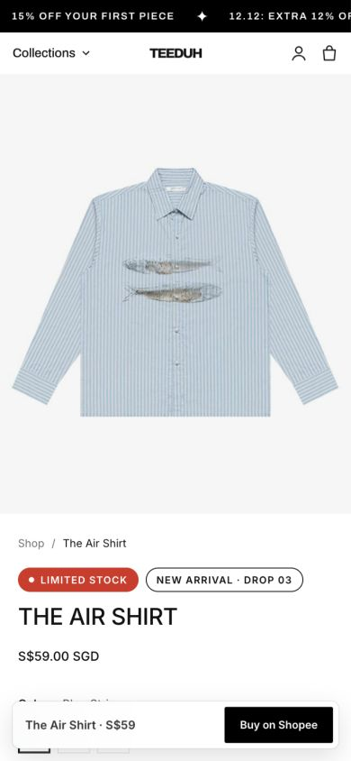

# Welcome to TEEDUH

**Dressed for the heat.**

TEEDUH is a fictional Singapore fashion brand created for a student website project by **Studio Empat: Michael Joseph Candra, Celine Emily Wijaya, Aisha Tasya Aulia and Muhammad Rizki**. The idea starts with a familiar part of life here: walking through hot, humid streets, then stepping into a room with strong air conditioning. The website presents a collection of everyday clothing around those two settings.

Visitors can browse 12 products, compare colours and sizes, explore outfit ideas, and read practical guides before following a link to Shopee or Lazada. The project brings brand storytelling, product information and a proposed shopping journey together in a responsive website built with **HTML and CSS**.



*The homepage introduces the collection through three campaign images. The main call to action takes visitors to the catalogue.*

## The project at a glance

| Item | Details |
| --- | --- |
| Project | TEEDUH sales website |
| Team | Studio Empat, a four-person student agency |
| Course and tutorial | CS2024, T02 |
| Brand context | Fictional fashion label for everyday life in Singapore |
| Collection | Drop 03, with 12 product pages |
| Website | 35 HTML pages and one shared stylesheet |
| Technology | HTML, CSS and locally stored images; no JavaScript or package installation required |
| Current scope | A storefront prototype with interactive browsing and placeholder external services |
| Repository | [AeruSeishiro/teduh-site](https://github.com/AeruSeishiro/teduh-site) |

This student prototype demonstrates product browsing, styling inspiration and a proposed journey to external marketplaces. Its marketplace links and form connections are placeholders.

## Take a tour

Start with the homepage, then follow the collection into the catalogue and a product page. The remaining pages help visitors decide how to wear a piece, choose a size and find answers before buying.

The page links below open source files when this README is viewed on GitHub. To explore the rendered website and its interactions, follow [Run the website locally](#run-the-website-locally), then use the site's navigation.

### 1. Meet the brand on the homepage

Open [index.html](index.html).

The opening screen pairs the line “Dressed for the heat” with campaign imagery and a direct route into the collection. Scrolling introduces three product showcases: Core essentials, Bottoms and Women's edit. These contain five, four and three product slides respectively.

Try the carousel controls and colour swatches, then browse the horizontal product rails. Product cards provide alternate images and quick links to available size options on the product page. Further down, a jacket reveal introduces the collection story through a scroll-driven effect in supporting browsers.

The page moves from the brand idea to individual pieces, then closes with styling inspiration and links to the rest of the site.

### 2. Browse the catalogue

Open [shop.html](shop.html), or use the Women and Men links for collection-specific selections.



*The catalogue combines an introductory product feature with controls for narrowing the collection and changing the size of the product cards.*

Choose **Category → Tops**, **Fit → Men**, then **Sort → Price: low to high**. The matching pieces are the Rose Wash Tee, Pleat Henley Top, Stripe Knit Polo and Air Shirt, in ascending price order. This gives a short example of how category, fit and sorting work together.

Switch between the Large, Medium and Small grid options to compare a detailed view with a compact overview. The Small view focuses on the images and hides the extra card information. The count below the grid reflects the displayed products; the toolbar total describes the full collection on that page.

### 3. Look closely at a product

Open [air-shirt.html](air-shirt.html).



*The product page puts the gallery beside the information needed to choose a piece: its price, colours, sizes and product details.*

Select White or Light Grey to change the main product image and colour label. Choose a size, then open Product Highlights, Product Details, and Delivery & Returns. The related-product section provides another route through the collection.

Colour and size choices are visual selections within the page. They are not sent to a marketplace, and the quick-size links on catalogue cards open the product page without adding anything to a cart. The Shopee and Lazada buttons demonstrate where the purchase journey would continue once real listing links are connected.

### 4. Find an outfit in the lookbook

Open [lookbook.html](lookbook.html).



*The lookbook presents clothing in everyday settings and connects each outfit to relevant catalogue pages.*

Explore the outfit cards and follow their product links. The looks cover settings such as campus, office days, brunch, night markets and rainy afternoons. The Style guide link leads to advice further down the same page.

These images are campaign styling concepts. They illustrate the intended mood and outfit combinations; they are not customer photographs or proof that each pictured garment exactly matches a catalogue product.

### 5. Read, compare and find help

The supporting pages give the collection more context and help visitors work through practical questions.

| Page | What to explore |
| --- | --- |
| [Journal](journal.html) | Seven articles about clothing care, campus life, office outfits, dressing for the heat, hawker-centre lunches, monsoon weather and travel. Each article connects its topic to products and related reading. |
| [Size guide](size-guide.html) | Switch between Tops & dresses, Bottoms and Unisex shirts, then use the measurement guidance. |
| [Fabric & sustainability](fabric.html) | Read the proposed material story, illustrative comparison bars and future sustainability goals. These are project content, not measured results or verified business achievements. |
| [Community](community.html) | Shop a monthly community pick and ten AI-generated styling concepts (six link to the products in them), plus the proposed outfit-sharing campaign. The gallery and scrolling social strip are static content, not a live social-media feed. |
| [FAQ & delivery](faq.html) | Expand questions about products, ordering, delivery and returns. |
| [Our story](about.html) and [Team](team.html) | Read the fictional brand story and see the student team and its listed responsibilities. |
| [Contact](contact.html), [welcome offer](get-15-off.html) and [Privacy](privacy.html) | Inspect the contact and voucher form layouts, consent choices and explanatory privacy copy. Form delivery is not configured. |

### 6. Try the mobile layout

The layout adapts to a narrow screen. The homepage uses one campaign image, product content stacks vertically, and the product page places a purchase link along the bottom of the screen.

<table>
  <tr>
    <td></td>
    <td></td>
  </tr>
  <tr>
    <td>Mobile homepage</td>
    <td>Mobile product page</td>
  </tr>
</table>

*The mobile views above were captured at 390 × 844 pixels. The desktop views were captured at 1440 × 960 pixels. They show the current layout at those sizes, rather than every possible device configuration.*

## How the website works

All pages share [css/style.css](css/style.css). Layout, typography, colour choices and responsive rules are managed there. The visual system uses black and white, pale grey product backgrounds, and Archivo, Inter and Work Sans from Google Fonts.

| Feature | Implementation |
| --- | --- |
| Menus, product carousels, colour choices and size-guide tabs | HTML form controls and CSS state selectors |
| Catalogue filters, sorting and grid density | CSS selectors and layout rules; filter panels use native HTML popovers |
| FAQs and product information | Native HTML disclosure elements |
| Product-image changes | CSS hover, focus and selected states |
| Jacket reveal and some scrolling effects | Modern CSS animation features, with simpler fallback presentation |
| Contact and voucher forms | HTML forms intended for Formspree; connection still required |

Some effects depend on browser support for newer CSS and HTML features. The stylesheet includes fallback and reduced-motion rules. The screenshots show appearance; they do not demonstrate every interaction or establish identical behaviour in every browser.

## Page and asset structure

The 35 HTML files comprise **12 product pages, seven journal articles and 16 other pages**, including Privacy and the 404 page.

| Group | Files or location |
| --- | --- |
| Home and collections | `index.html`, `shop.html`, `women.html`, `men.html` |
| Product pages | `air-shirt.html`, `breeze-pant.html`, `rose-tee.html`, `stripe-knit.html`, `dot-tank.html`, `tie-top.html`, `sheer-dress.html`, `wrap-skirt.html`, `suede-skirt.html`, `zip-jacket.html`, `pleat-henley.html`, `drift-shorts.html` |
| Editorial and brand | `lookbook.html`, `fabric.html`, `journal.html`, seven `journal-*.html` articles, `community.html`, `about.html`, `team.html` |
| Help and forms | `size-guide.html`, `faq.html`, `contact.html`, `get-15-off.html`, `privacy.html`, `404.html` |
| Shared styling | `css/style.css` |
| Current catalogue photography | `images/catalog/` |
| Current campaign styling images | `images/instagram/` |
| README screenshots | `docs/screenshots/` |

The repository also retains older images directly inside `images/`. Most are no longer referenced by the current pages. The screenshots in this README show the rendered site rather than those earlier assets.

## Run the website locally

Install Git and Python 3 if they are not already available. Download the repository and start a local server:

```bash
git clone https://github.com/AeruSeishiro/teduh-site.git
cd teduh-site
python3 -m http.server 8000
```

Open [http://localhost:8000](http://localhost:8000) in a browser. If Python 3 is installed as `python` on your computer, use `python -m http.server 8000` instead. Keep the terminal open while viewing the site, and press `Ctrl+C` when finished.

There is no build step. The local HTML, CSS and image files are served directly. Google Fonts and external destination links need an internet connection.

For an existing checkout, commit or stash any local edits first, then update the main branch:

```bash
git switch main
git pull --ff-only origin main
```

## Team and credits

The [Team page](team.html) lists these roles:

| Team member | Role |
| --- | --- |
| Michael Joseph Candra | Project Manager |
| Celine Emily Wijaya | Front-end Developer |
| Aisha Tasya Aulia | Copywriter |
| Muhammad Rizki | UI/UX Designer |

Catalogue photographs were supplied from **Drunk Dad**. Original product references and image records are documented in [images/catalog/source-map.json](images/catalog/source-map.json). TEEDUH's fictional product names and prices are part of this project.

The ten campaign images are recorded as **AI-generated styling concepts** in [images/instagram/source-map.json](images/instagram/source-map.json). They appear in the homepage, lookbook, community gallery and other editorial sections. The README screenshots capture the website using these existing assets.

The original project notes identify Hanzify's **Lite 001** theme as a temporary visual reference. Fonts are provided through Google Fonts. The repository currently has no dedicated license file.

*This walkthrough and its screenshots were prepared from source revision `b551b40` on 12 November 2026.*
